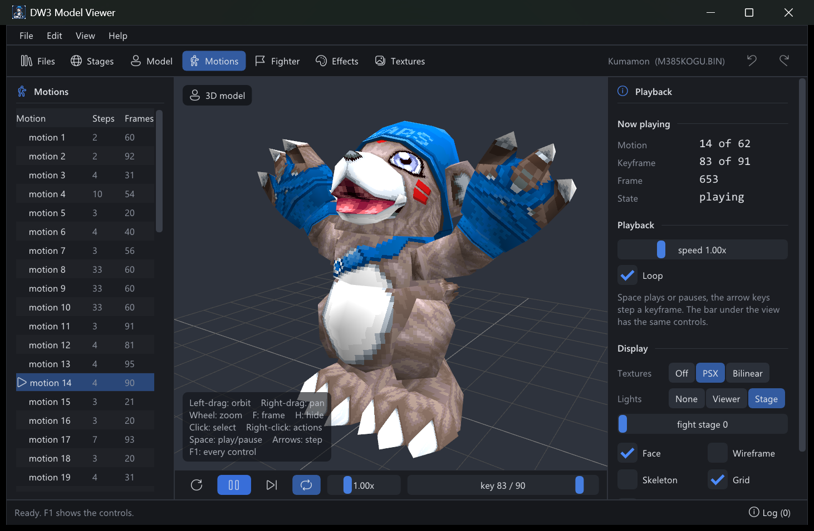
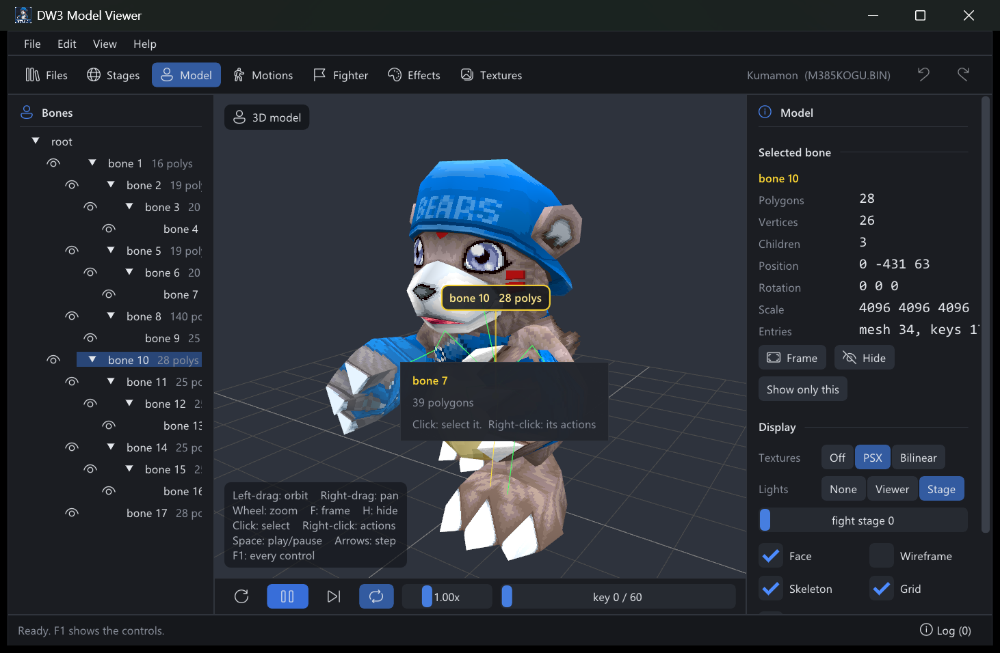
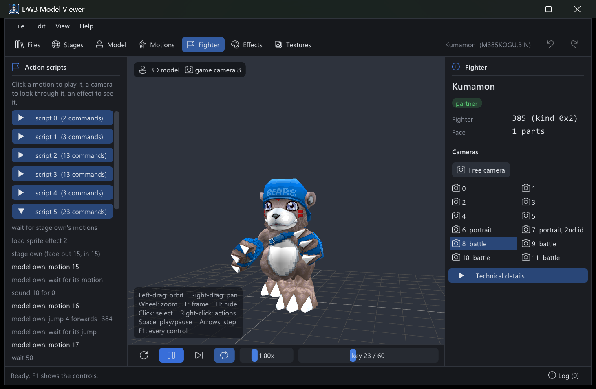
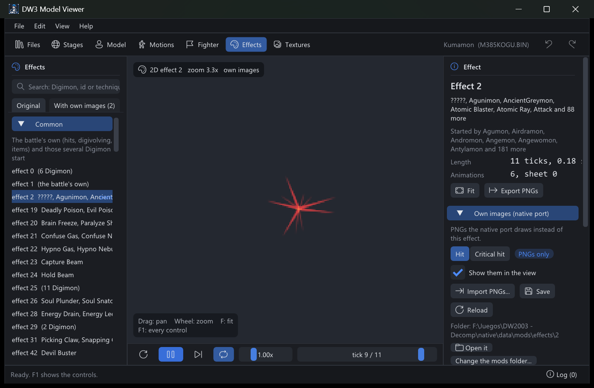
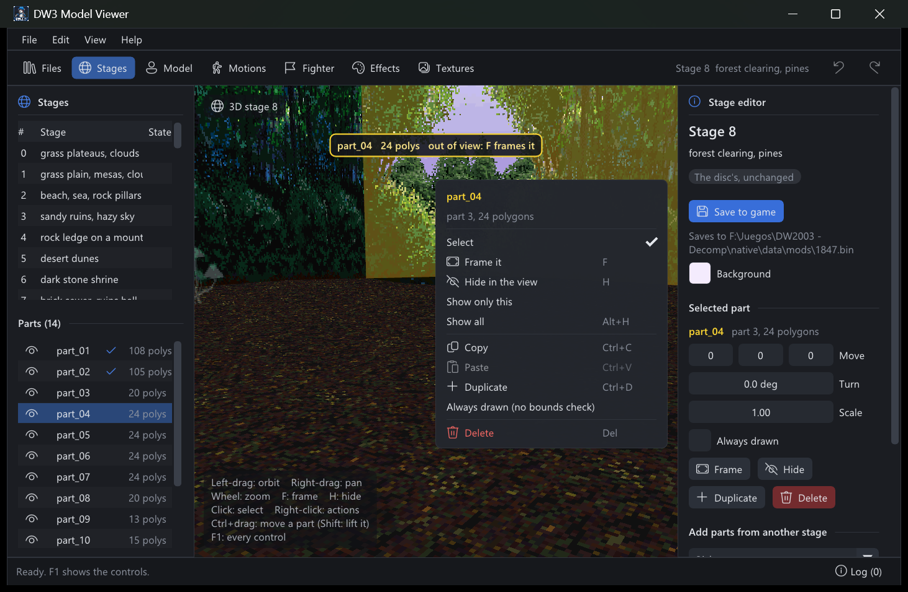
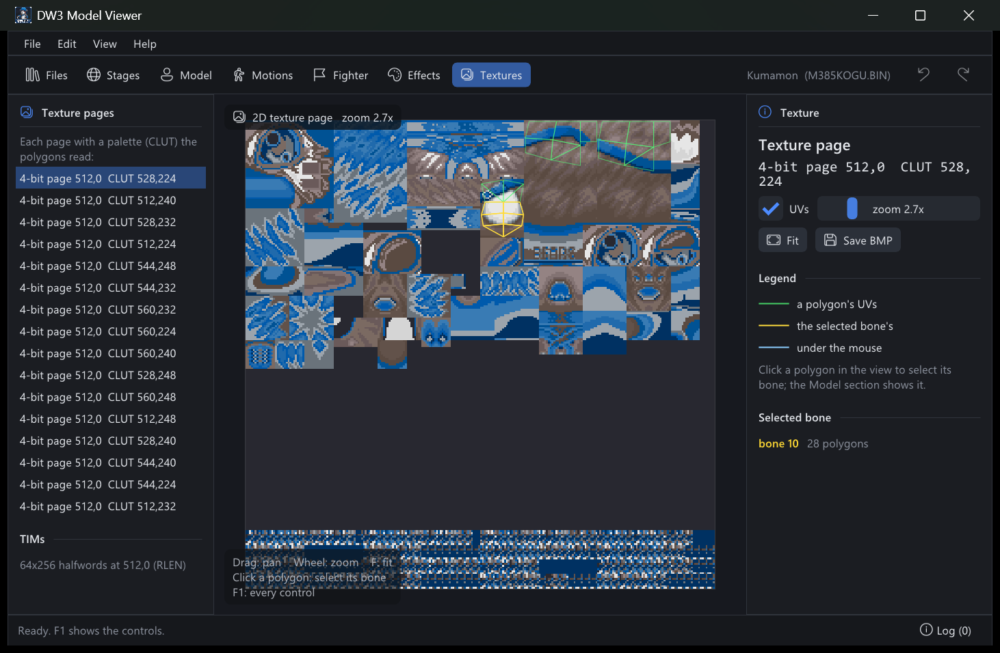

# DW3 Model Viewer

A viewer for the battle models of **Digimon World 2003** (PAL, SLES-03936), in the
spirit of Half-Life's model viewer: open a model and look at its mesh, its textures and
their UVs, its skeleton, and each of its motions, frame by frame.

It never changes the game's own files: what you edit with it (effects' images, fight
stages) goes to the native port's mods folder. **No game data is included**; it reads
the models from your own disc image.

This is a fan project, not affiliated with or endorsed by Bandai Namco. Digimon is a
trademark of its owners.

## What it shows

- **Models**: every battle model on the disc. That's 434 files, from FIGHT/MODEL (the
  Digimon) and FIGHT/EFFECT (DNA forms and technique models), by the names the game
  gives them: the Digimon's, or the technique's for an effect model.
- **Mesh**:
  - textures off, as the PSX draws them (nearest texels), or bilinear-filtered (a
    preview of a smoother look);
  - lights: a fight stage's own (its three lights and ambient color, worked out as the
    PSX does), a plain viewer light, or none;
  - the face as in battle: the eyes blink, close when hit, and the other face parts
    cycle;
  - wireframe, back-face culling and a floor grid.
- **Skeleton**:
  - the bone tree, with each part's mesh;
  - show or hide any part, and select one (click it in the view or the tree): it turns
    yellow and its name shows over it;
  - hover a bone for its entries in the file and its current position, rotation and
    scale.

  
- **Motions**:
  - each of a fighter's motions (62 for the Digimon);
  - play, pause, step one keyframe, restart, loop, speed from 0.05x to 4x, and a
    keyframe slider;
  - the blends between motions play as the game plays them.
- **Fighter** (from the battle's fighters' file, SMDLDATA.PRO):
  - each fighter that uses the model, partner or enemy;
  - its cameras, seen as the game frames them and named by what the game uses each
    for: a partner's six battle views (the default view the battle returns to between
    actions; the game picks one by the enemy's number of cameras), its two portraits
    (the battle menu's, and the one for low HP) and its four battle shots (the
    second is the Digimon change's, the third the entrance's); an enemy's three
    shots (the third is its entrance's);
  - its action scripts, decoded: the motions, cameras, effects, sounds and waits of
    each technique and reaction, grouped by what they are: the reactions to a hit, a
    knockout and an evade; the basic attack; the physical, magic, signature and DNA
    techniques; support and field ones. The scripts that no technique's number names
    stay as "Script N" (hover one for what uses it). Click a motion to play it, a
    camera to look through it;
  - **Play the script** runs it as the battle does: the motions and their waits, the
    cameras (the view stays where the battle puts it, the default view first, unless
    you uncheck "Keep the game's camera"), the sprite effects and the effect models.
    A sprite effect draws where the battle puts it: at its point in the world, sorted
    with the models by its depth (a fighter in front hides it), or at a screen
    position when the script gives one, in front of the models or behind them; an
    attack's is at the enemy's side, out of sight of the partner's own cameras (the
    view says so). Effect models (the 3D effects, like Thundermon's lightning ring)
    play from their first motion where the script puts them. A script's "own" sprite
    effect is its technique's: pick which technique's look it plays (the Fight
    command's is effect 2). It leaves out the jumps and moves, the other side's
    fighter, the sounds, the fades, the stages and the models a script adds.
    A checkbox picks what plays for an effect that has own images in the mods
    folder: those (the mod) or the original sprites.

  
- **Effects** (the battle's 2D effects: hit sparks, techniques' sprites):
  - every sprite effect, played as the battle plays it: each of its sprite
    animations' frames, palettes, offsets, scales and rotations, blended as the PSX
    blends them;
  - play, pause, restart, loop, speed, and a slider over its ticks (1/60 s each, as
    the battle counts time: an effect lasts ticks / 60 seconds);
  - export its frames as PNGs (30 a second, with a transparent background), and open
    their folder;
  - the list in two tabs: Original, grouped into Common (the battle's own, and those
    several Digimon start) and By Digimon (each one's own, from the action scripts),
    and With own images;
  - click an action script's "sprite effect" line to see it;
  - **own images for the native port**: import PNGs into the port's
    `data/mods/effects/<id>/` (or its `critical/`, for a critical hit; pick the
    folder with "Change the mods folder..."), see them play in the effect's place, and
    set each frame's PNG and ticks (reorder, duplicate, copy and paste, remove, undo),
    the offset, scale and blend (alpha or add); Save writes the folder's `effect.json`,
    which the port plays as shown.

  
- **Stages** (the 57 fight stages, in a section of their own):
  - each one inside, as a battle sees it, with its background color;
  - its parts (ground, props, panorama): click one in the view or the list to move
    (also Ctrl+drag in the view), turn or scale it, duplicate, copy, paste or remove
    it; a selected part has a gizmo in the view (arrows move it, the ring turns it, the
    box scales it) and X / Y / Z fields (up is positive); hide it in the view, or mark it Always drawn to skip the bounds check (the
    ground's and the panorama's); Ctrl+Z undoes;
  - add parts from any other stage with the catalog: a window with a picture of every
    part of the 57 stages, a search and a stage filter (a forest's trees in another
    stage), fixed where they stood;
  - export it as an OBJ with its MTL and PNGs (y up, 1 unit = 100 of the game's) to
    edit in Blender, and import it back: each object is a part (keep their names to
    keep their keys), its textures repacked into the stage's three texture pages, 16
    colors a piece, shrunk only when they don't fit;
  - **Save to game** writes the stage in the game's own format to the native port's
    `data/mods/<file>.bin` (with the stages' table, `0459.bin`), which the port reads
    instead of the disc's when it starts; **Revert to the disc's** takes it back.
    Stages 0 and 1, and 34 and 56, share their model.

  
- **Textures**:
  - every texture page and palette pair the polygons use, decoded;
  - the UVs drawn over it (the selected part's in yellow);
  - save one as a BMP: the starting point for redrawing a texture.

  

## Requirements

- **Windows 10 or 11**, 64-bit, with a graphics card that supports **OpenGL 3.3** (any
  card or integrated graphics from the last ten years). Only Windows for now.
- **Your own copy of the game**: Digimon World 2003 (Europe), SLES-03936, as a disc
  image, either a `.bin`/`.cue` pair or a `.iso`. Other versions (Digimon World 3,
  USA/Japan) aren't supported: the file tables are read from the European executable.
- **Python 3.8 or later** ([python.org](https://www.python.org/downloads/)), to read the
  models from your disc image (and to build from source).

## Download

1. Download `dw3-model-viewer-<version>-win64.zip` from
   [Releases](https://github.com/Feerdus95/dw3-model-viewer/releases) and unpack it.
2. In the unpacked `dw3-model-viewer` folder, read the models from your disc (once):

       python tools/setup_disc.py "path/to/Digimon World 2003 (Europe).cue"

   This takes a few seconds and writes `data/` next to the exe: the 434 battle model
   files (about 17 MB), the battle's data on its fighters (names, cameras, lights) and
   the disc's file names. Given a `.cue`, it reads the `.bin`
   with the same name next to it; if yours is named differently, give the `.bin`
   itself. It checks the disc first: if it says "this isn't Digimon World 2003
   (Europe), SLES-03936", the image is another version or is damaged.
3. Run `dw3mv.exe`.

## Building from source

On top of the requirements above:

- **A MinGW-w64 C++ compiler for x86_64.** Either one works:
  - **llvm-mingw**: download `llvm-mingw-<date>-ucrt-x86_64.zip` from
    [its releases](https://github.com/mstorsjo/llvm-mingw/releases), unpack it, and add
    its `bin` folder to `PATH`;
  - **MSYS2**: from [msys2.org](https://www.msys2.org/), run
    `pacman -S mingw-w64-ucrt-x86_64-gcc`, and add `C:\msys64\ucrt64\bin` to `PATH`.
- **SDL3's development files for MinGW**: download `SDL3-devel-<version>-mingw.zip`
  (3.2 or later) from [SDL's releases](https://github.com/libsdl-org/SDL/releases) and
  unpack it into `third_party/`, so that `third_party/SDL3-<version>/` exists.
- **Dear ImGui** is already in `third_party/imgui`.

### 1. Get the source

    git clone https://github.com/Feerdus95/dw3-model-viewer.git
    cd dw3-model-viewer

Or download it as a ZIP from GitHub's **Code** button and unpack it. Every command
below runs from this folder.

### 2. Read the models from your disc

    python tools/setup_disc.py "path/to/Digimon World 2003 (Europe).cue"

As in [Download](#download): it writes `data/` in this folder, once.

### 3. Build

    python build.py

This makes `build/dw3mv.exe` and copies `SDL3.dll` next to it. The compiler is the
first of these found: `$CXX`, `x86_64-w64-mingw32-clang++`, `x86_64-w64-mingw32-g++`,
`clang++`, `g++`. To use SDL3 from elsewhere, set `SDL3_DIR` to its folder.

If it fails:
- **"no C++ compiler"**: the compiler's `bin` folder isn't on `PATH`. Open a new
  terminal after changing `PATH`.
- **"no SDL3"**: `third_party/SDL3-<version>/` is missing, or it isn't the MinGW
  package (it needs `x86_64-w64-mingw32/include/SDL3/SDL.h`).

### 4. Run

    build\dw3mv.exe

Or double-click `dw3mv.exe` in the `build` folder.

### Making a release

    python tools/package.py v0.1.0

It builds, packs `build/dw3-model-viewer-v0.1.0-win64.zip` (the exe, `SDL3.dll`,
`setup_disc.py`, this README and the licenses), then unpacks it to a temporary folder
and checks that it reads every model.

## Troubleshooting

To check a setup, `dw3mv.exe --check | more` reads every model and should end with
`434 models, 0 unread`. (It's a window app: in cmd or PowerShell, pipe its output, as
here, so that the prompt waits for it.)

- **"SDL3.dll was not found"**: `SDL3.dll` must be next to `dw3mv.exe`.
- **"This needs a graphics card with OpenGL 3.3"**: update the graphics driver. On a
  remote desktop or a virtual machine there may be no OpenGL 3.3.
- **The list of models is empty**: `data/` is missing; run `setup_disc.py` again, or
  pick it with **File > Change the data folder...** (it's remembered in `data_dir.txt`).
  Otherwise the viewer looks for it next to the exe, or next to its `build` folder.
- **"python" isn't recognized**: install Python from python.org with **Add python.exe
  to PATH** ticked, then open a new terminal.

## Use

The sections are along the top. Each has a browser on the left (what to open) and an
inspector on the right (what's open or selected); the view is in between, with a
playback bar under it for motions and effects. Drag a panel's inner edge to resize it;
**Ctrl+B** and **Ctrl+I** hide them. The status bar shows the last message, and
**Log** shows them all.

- **Files**: the disc's models by name, file name and file number (the stages' are
  in Stages). The search takes part of any of them (`Monmon`, `M384`, `KOET`). You can
  also drop a model's `.BIN` on the window, or open one with **Ctrl+O**.
- **Stages**: the fight stages, their parts, and the open stage's editor (see above).
  **F** frames the selected part, or looks from the arena's middle again.
- **Model**: the bone tree (the eye shows or hides a bone), the selected bone's data and
  the display options (textures, lights and their stage, face, wireframe).
- **Motions**: the motion list. Motions play at 60 keyframes a second at 1x, the rate
  the game steps them.
- **Fighter**: the action scripts, the fighter (pick one when several use the model) and
  its cameras (**Free camera**, or any drag in the view, goes back to orbiting).
- **Effects**: the 2D effects and their own images for the native port.
- **Textures**: the texture pages in the view, with the UVs over them; click a polygon
  to select its bone. **Save BMP** writes the page shown next to `dw3mv.exe`, named
  after the model, the page and the palette.
- **Help > About**: the version, license and credits.

Click a bone or a stage's part in the view to select it: it turns yellow, its name
shows over it (the name the lists use) and the lists show it too. Hovering shows what's
under the mouse. Right-click anything, in the view or a list, for its actions.

| Control | Action |
|---|---|
| Left drag | orbit |
| Right or middle drag | pan |
| Wheel | zoom (in the 2D views, about the mouse) |
| Click / right-click | select / its actions |
| Ctrl+drag, Shift+Ctrl+drag | move a stage's part on the ground / up and down |
| F | frame the selection (or everything) |
| H, Alt+H | hide the selection, show everything |
| Space, Left / Right | play / pause, step |
| Ctrl+C, Ctrl+V, Ctrl+D, Del | copy, paste, duplicate, delete a stage's part or an own images' frame |
| Ctrl+Z, Ctrl+Y | undo, redo the stage's or the own images' edits |
| Ctrl+S | save the stage, or the own images |
| F1 | every control |

The window's size, position and panel widths are remembered (`settings.ini`, next to the exe).

A part copied with Ctrl+C pastes into another stage too. Leaving a stage or an effect
with changes you haven't saved, quitting, or reverting a stage asks first.

### Command line

    dw3mv [file.bin]                      opens the viewer, and the model
    dw3mv --data DIR                      reads data/ (files and names.txt) from DIR
    dw3mv --check                         reads every model, prints a line for each
    dw3mv --effect ID                     saves 2D effect ID's frames as PNGs in
                                          effects/effect_ID next to the exe
    dw3mv --effect-users                  prints which Digimon's action scripts start
                                          each 2D effect
    dw3mv --stages                        builds every stage back (and through an
                                          OBJ) and checks what changed: nothing
    dw3mv --shot out.bmp [--motion N] [--key K] [--cam N] [--stage N] [--fighter N] file.bin
                                          draws one frame to a BMP and exits: at a
                                          motion's keyframe, through a fighter's
                                          camera, with a stage's lights

By default `data/` is the one picked with **File > Change the data folder...** (kept in `data_dir.txt`), or next to the exe, or next to its `build` folder.

## How it reads a model

The reading is a port of what the game itself does, from the dw3_decomp decompilation
(`src/fightstg/fightstg.c`, `src/main/gfx/tim_loader.c`, and for the fighters
`fighter_info.c`, `face.c`, `battle_script.c`, `lights.c`), not a guess at the format.

- **The file** is an archive, a table of offsets. Its parts:
  - **bone list**: the texture entry, then each bone's parent, mesh and keys;
  - **meshes**: vertices, normals, and command bytes that set the texture, flags and
    colors, then list the polygons (triangles and quads, flat or gouraud, lit or not,
    semi-transparent);
  - **keys**: a bone's positions, rotations (4096 = 360°) and scales, each at a frame
    of one timeline every motion shares;
  - **motions**: each a list of steps that play ranges of that timeline or blend into
    the next;
  - **textures**: RLEN-compressed TIMs, palettes included.
- **The fighters' file** (SMDLDATA.PRO) names each fighter's bone list, motions,
  scripts, face parts and cameras; its names come from the battle's text files.
- **Textures** are placed in an emulated 1024×512 VRAM. The shader looks each texel up
  through its page and palette, as the PSX does.
- **Bones**: each one's matrix is built as the game builds it (Z·Y·X rotation, then
  scale), and a bone scaled under 48/4096 is hidden.

`src/model.cpp` reads and poses a model, `src/game.cpp` reads the fighters' data and
`src/effect.cpp` reads and draws the 2D effects, `src/custom.cpp` an effect's own images for the native port, with no OpenGL in any. `src/main.cpp` is the window, the renderer and the interface, its parts in `src/modules/*.inc` (one translation unit).

## Not there yet

- **Export and replacement** of models and textures, beyond saving a texture as a BMP.
- **Reading the disc without Python**: dropping the disc image on the viewer.
- **Playing a whole action script**: its effects in place, sounds and the other side's
  model; for now a script's motions, cameras and effects play one at a time.
- **Names in other languages**: they are the English ones.

## License

MIT, see [LICENSE](LICENSE). The game and its data are not covered: they belong to their owners.

## Credits

See [CREDITS.md](CREDITS.md):
- the model reading is ported from **dw3_decomp** (MIT);
- **Dear ImGui** 1.91.8 (MIT, `third_party/imgui`);
- **SDL3** (zlib), linked as `SDL3.dll`.
